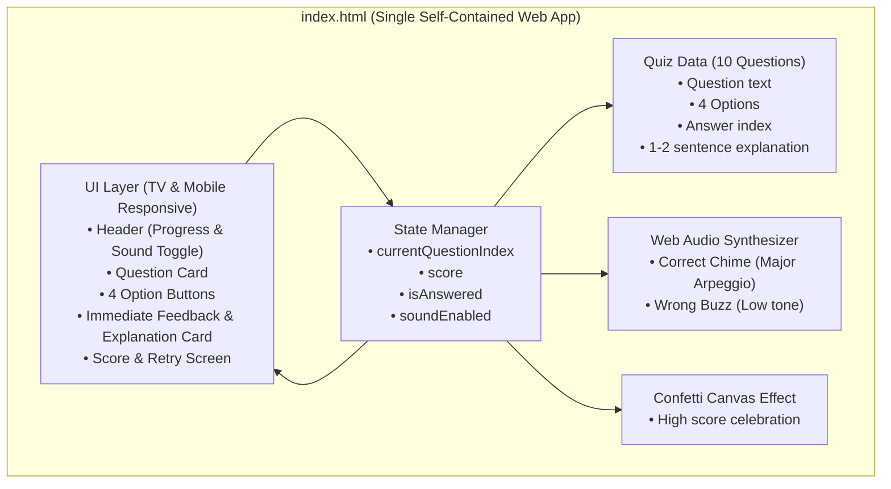

# 중학교 3학년 '조선 시대 문화' 퀴즈 웹앱 구현 계획

> **For agentic workers:** REQUIRED SUB-SKILL: Use superpowers:subagent-driven-development to implement this plan task-by-task. Steps use checkbox (`- [ ]`) syntax for tracking.

**Goal:** 중학교 3학년 사회(역사) '조선 시대 문화' 단원을 학습/복습할 수 있는 고가독성 반응형 단일 파일 퀴즈 웹앱(`index.html`)을 제작하고, Git 커밋 및 GitHub 리포지토리 생성/푸시, GitHub Pages 배포를 완료한다.

**Architecture:** 단일 정적 웹 애플리케이션(`index.html`)으로 구축하며, 외부 의존성 없이 시맨틱 HTML5, CSS3 변수 기반의 반응형 대형 폰트 타이포그래피, 바닐라 JavaScript 모듈(상태 관리, 퀴즈 엔진, Web Audio API 사운드 합성기, 캔버스 폭죽 효과)로 구성한다.

**Architecture Diagram:**

**Tech Stack:** HTML5, Modern CSS3 (Flexbox/Grid, CSS Variables, Fluid Typography clamp()), Vanilla JavaScript (ES6+), Web Audio API (OscillatorNode, GainNode), HTML5 Canvas.

**Spec:** [docs/superpowers/specs/2026-10-14-joseon-culture-quiz-design.md](file:///d:/antigravity/history-quiz/docs/superpowers/specs/2026-10-14-joseon-culture-quiz-design.md)

## Global Constraints
- 단일 독립형 실행: `index.html` 더블 클릭만으로 교실 TV 및 스마트폰에서 오프라인 완벽 구동
- 폰트 및 가독성: WCAG AAA 수준의 높은 명도 대비, TV에서도 선명하게 보이는 최소 24px~36px의 시원한 폰트 크기
- 4지선다 10문제: 중학교 3학년 사회/역사 조선 문화 핵심 성취기준 100% 반영
- 즉각 피드백: 정답/오답 즉시 시각 강조 + 1~2문장의 명료한 쉬운 해설 제공
- 사운드: 외부 파일 로드 없이 Web Audio API로 자체 합성, 우측 상단 음소거 버튼 제공
- 완료 화면: 총점(100점 만점 / 10문항) 및 '다시 풀기' 버튼 제공

---

### Task 1: 퀴즈 데이터 및 핵심 상태 관리 로직 작성 (`quiz-data.js` & 퀴즈 엔진)

**Files:**
- Create: `d:/antigravity/history-quiz/quiz-data.js`
- Test: `d:/antigravity/history-quiz/tests/test_quiz_data.js`

**Interfaces:**
- Produces: `QUIZ_QUESTIONS` (10개 문항 배열), `QuizEngine` (상태 관리 및 채점 클래스)

- [ ] **Step 1: 퀴즈 데이터 유효성 검증 테스트 작성 (`tests/test_quiz_data.js`)**
  - 문항 개수가 정확히 10개인지 검증
  - 각 문항이 `id`, `question`, `options`(길이 4), `answerIndex`(0~3), `explanation`을 가지는지 검증
  - 각 해설이 1~2문장의 한국어로 충실하게 작성되었는지 검증

- [ ] **Step 2: 테스트 실행 및 실패 확인 (Node.js)**

- [ ] **Step 3: 10개 문항 데이터 및 QuizEngine 작성**

- [ ] **Step 4: 테스트 실행하여 통과 확인**

- [ ] **Step 5: Git 초기화 및 커밋**

---

### Task 2: 완전한 독립형 웹앱 구현 (`index.html`)

**Files:**
- Create: `d:/antigravity/history-quiz/index.html`

**Interfaces:**
- Consumes: `QUIZ_QUESTIONS`, `QuizEngine` 로직
- Produces: 교실 TV 및 모바일 완벽 대응 단일 파일 웹앱

- [ ] **Step 1: 시맨틱 HTML 및 반응형 고대비 CSS 레이아웃 구성**
  - 모바일 터치 및 대형 스크린(TV) 뷰포트 메타태그 설정
  - 1번~10번 문항 진행 상태 프로그레스 바, 사운드 토글(🔊/🔇) 버튼
  - 큼직한 질문 영역과 4개 선택지 버튼 (Hover, Focus, Active 상태 애니메이션)
  - 선택 즉시 노출되는 피드백 카드 (정답/오답 태그, 1~2문장 해설, '다음 문제' 버튼)
  - 결과 화면 (점수, 등급별 칭찬 메시지, '다시 풀기' 버튼)

- [ ] **Step 2: Web Audio API 사운드 효과 및 Canvas 폭죽 구현**
  - 정답 차임 사운드 (도-미-솔-도 아르페지오)
  - 오답 버저음 (로우 톤 사인파)
  - 80점 이상 획득 시 결과 화면 캔버스 콘페티(폭죽) 축하 효과

- [ ] **Step 3: 브라우저 자동화(Playwright)를 통한 E2E 테스트 및 시각적 검증**
  - 모바일 해상도(375x667) 및 대형 TV 해상도(1920x1080) 렌더링 확인
  - 1번부터 10번까지 문제 풀이 인터랙션, 즉각 피드백 노출 검증
  - 최종 점수 화면 및 '다시 풀기' 리셋 동작 검증
  - 스크린샷 캡처 및 가독성 확인

- [ ] **Step 4: 커밋**

---

### Task 3: GitHub 리포지토리 생성, 원격 푸시 및 GitHub Pages 배포

**Files:**
- Create: `d:/antigravity/history-quiz/README.md`
- Config: Git remote 및 GitHub Pages 설정

- [ ] **Step 1: 깔끔한 소개 README.md 작성 (사용법, 교육과정 연계 내용, 온라인 링크 안내)**

- [ ] **Step 2: GitHub 인증 및 원격 리포지토리 생성/연결**

- [ ] **Step 3: main 브랜치 푸시**

- [ ] **Step 4: GitHub Pages 배포 활성화 및 라이브 URL 확인**

- [ ] **Step 5: 최종 검증 및 보고**
